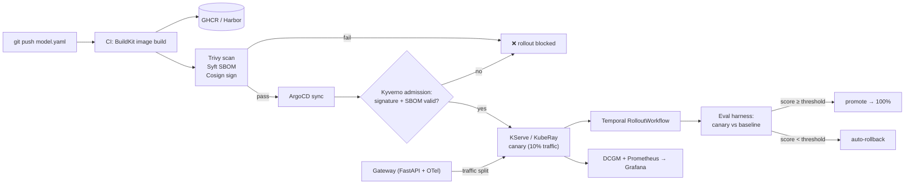

# modelship

> GitOps-driven LLM inference platform. Push a model spec, get a signed, scanned, canary-deployed inference service on Kubernetes — with Temporal-orchestrated rollouts that **evaluate before they promote**.


[](LICENSE)

**Status: 🚧 building in public — see the [roadmap](#roadmap).**

## The problem

Most teams deploy LLMs like stateless web services. That is wrong. A model release is not
code release: new weights can silently regress answer quality while every health check
stays green. `modelship` treats a model deployment as a first-class, verified event:

- every artifact is **scanned, SBOM'd and signed** before it can be admitted to the cluster
- every rollout is **canaried**, and the canary must pass an **eval suite against the current
  baseline** before it receives 100% of traffic
- if the eval gate fails, the platform **rolls back automatically**
- every request is **traced** end-to-end, and GPU telemetry is first-class

## How it works



Two loops:

1. **Push-time (the platform):** model spec → supply-chain-verified artifact → GitOps
   canary deployment → Temporal workflow gates promotion on eval results.
2. **Request-time (the serving path):** OpenAI-compatible gateway → traffic split →
   inference backend, traced with OpenTelemetry, metrics in Grafana.

## The model spec

Deployments are declared as code — this file is the entire interface:

```yaml
apiVersion: modelship.io/v1alpha1
kind: ModelDeployment
metadata:
  name: llama-3-2-3b-instruct
spec:
  model:
    source: huggingface:meta-llama/Llama-3.2-3B-Instruct
    revision: pin-to-commit-sha
  serving:
    backend: vllm            # vllm | llama.cpp
    quantization: awq        # none | awq | gguf-q4
  resources:
    accelerator: nvidia      # nvidia | metal | cpu
    gpuClass: l4
    replicas: 2
  rollout:
    strategy: canary
    canaryPercent: 10
    evalSuite: evals/suites/llama-3-2-3b.yaml
    promotionThreshold: 0.95
  supplyChain:
    requireSigned: true
    maxTrivySeverity: HIGH
```

Full reference: [docs/model-spec.md](docs/model-spec.md).

## Roadmap

| Phase | Scope | Status |
|-------|-------|--------|
| 1 | Cluster + first model serving (kind, KServe/KubeRay, Metal & NVIDIA paths) | 🚧 |
| 2 | Supply chain CI (BuildKit, GHCR/Harbor, Trivy, Syft, Cosign) | ⬜ |
| 3 | GitOps + canary (ArgoCD, Kyverno admission, Envoy Gateway traffic split) | ⬜ |
| 4 | Temporal rollout workflow + eval harness (auto-promote / auto-rollback) | ⬜ |
| 5 | Observability (OTel tracing, Prometheus, Grafana dashboards) | ⬜ |
| 6 | *stretch:* gateway hardening (auth, rate limiting, semantic cache) | ⬜ |

Progress is tracked in the [issues](https://github.com/naren1905/modelship/issues).

## Stack

| Layer | Technology |
|-------|------------|
| Serving | KServe or KubeRay (decision in ADRs), vLLM, llama.cpp (Metal) |
| Orchestration | Kubernetes (kind for dev, RKE2 for bare-metal), ArgoCD |
| Model lifecycle | Temporal workflows, custom eval harness |
| Supply chain security | BuildKit, GHCR/Harbor, Trivy, Syft, Cosign, Kyverno |
| Observability | OpenTelemetry, Prometheus, Grafana, DCGM exporter |
| Gateway | Python, FastAPI, Redis, Milvus (semantic cache) |
| IaC / CI | Terraform, GitHub Actions |

## Local development

Runs on an Apple Silicon laptop (Metal via llama.cpp) or any NVIDIA GPU node (vLLM +
GPU Operator + DCGM). Cluster bootstrap and per-phase setup land with Phase 1.

## Repository layout

```
specs/       example ModelDeployment manifests (the interface)
docs/        architecture, model spec reference, ADRs
platform/    cluster config: kind, ArgoCD, Kyverno, Temporal, CRDs
gateway/     OpenAI-compatible inference gateway (FastAPI + OTel)
lifecycle/   Temporal rollout workflows
evals/       eval harness: golden datasets, scorers, promotion gate
.github/     CI pipelines
```

## License

[MIT](LICENSE)
